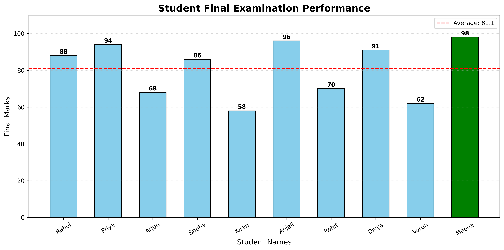
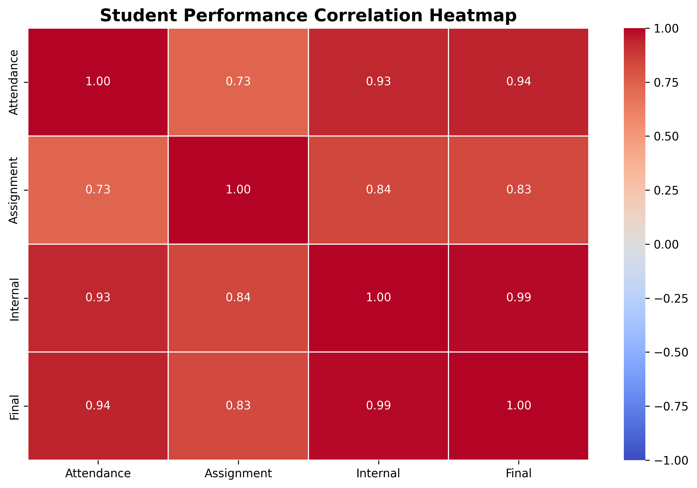
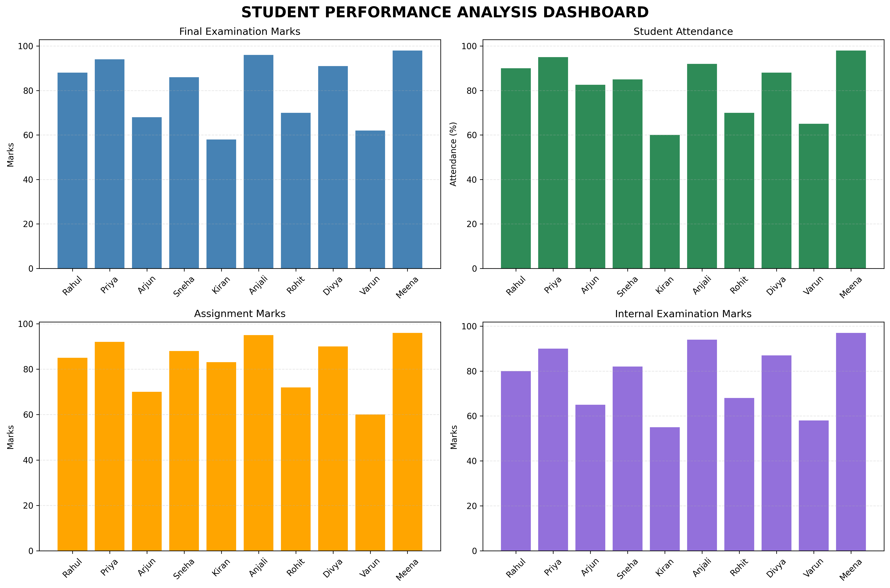
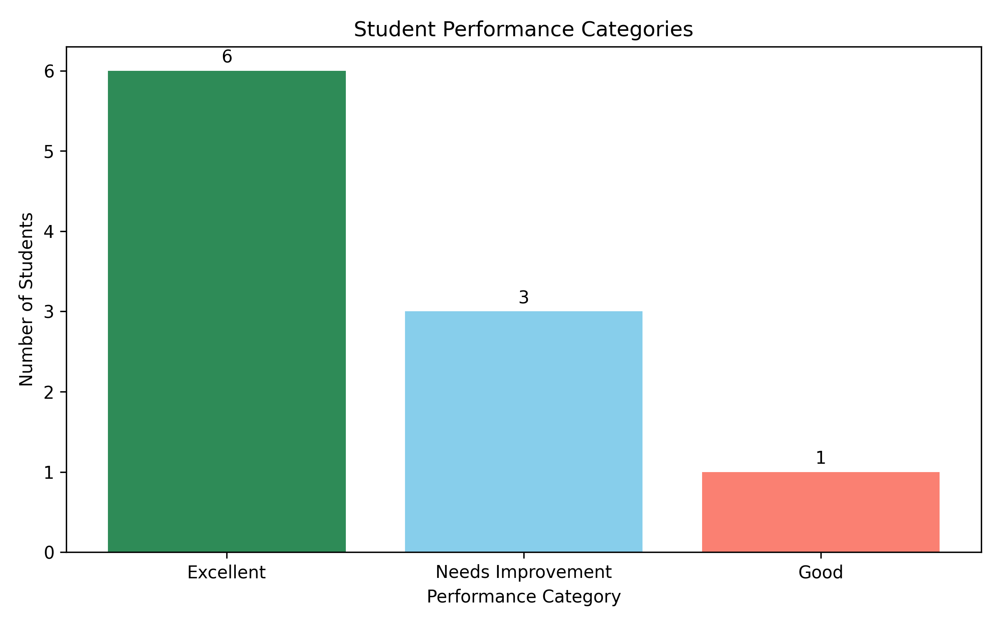

# Student Performance Data Analysis

## Project Overview
This project analyzes student academic performance using Python and Data Science libraries. It explores attendance, assignment marks, internal marks, and final examination results to identify performance patterns.

## Objectives
- Analyze student academic performance.
- Calculate average, highest, and lowest marks.
- Identify the top-performing student.
- Explore the relationship between attendance and final marks.
- Visualize results using charts.

## Technologies Used
- Python
- Google Colab
- Pandas
- NumPy
- Matplotlib
- Seaborn

## Dataset
The project uses a sample dataset containing 10 fictional students with the following details:
- Name
- Gender
- Attendance
- Assignment marks
- Internal marks
- Final examination marks

## Key Results

| Metric | Result |
|---|---:|
| Total Students | 10 |
| Average Assignment Marks | 83.11 |
| Average Final Marks | 81.10 |
| Average Attendance | 82.56% |
| Highest Final Marks | 98 |
| Lowest Final Marks | 58 |
| Top Performer | Meena |
| Attendance–Final Marks Correlation | 0.9433 |

## Visualizations

### Student Final Performance

### Correlation Heatmap

### Performance Dashboard

### Performance Categories

## Key Findings
- Meena achieved the highest final marks with 98.
- The average final examination score was 81.10.
- Attendance and final marks showed a strong positive correlation.
- Correlation does not necessarily mean causation.

## Future Improvements
- Use a larger real-world dataset.
- Apply Machine Learning to predict student performance.
- Build an interactive dashboard.
- Add more student performance indicators.

## Note
This project uses fictional sample data for learning and demonstration purposes.

## Author
**Charunya**

GitHub: [charunya1](https://github.com/charunya1)
